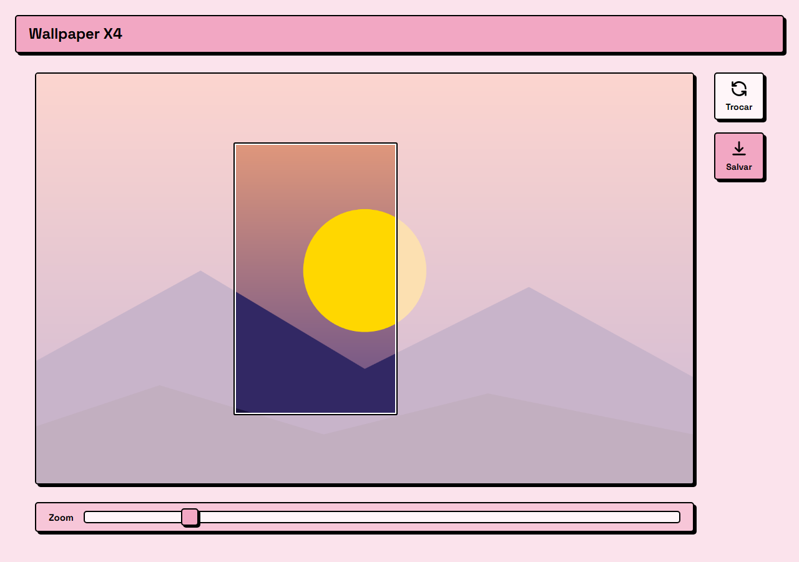

# Wallpaper X4

Converte qualquer imagem em um BMP 24-bit de 480×800, no formato de wallpaper do Xteink X4. Você escolhe a imagem, ajusta o recorte e baixa o arquivo.



## Como usar

1. Clique em **Enviar imagem** (ou arraste um arquivo para a caixa).
2. Arraste o retângulo para escolher a área do recorte.
3. Use o slider **Zoom** para aproximar o recorte.
4. Clique em **Salvar** para baixar `wallpaper-x4.bmp`.
5. Use **Trocar** para escolher outra imagem.

Tudo roda no navegador. A imagem não é enviada para nenhum servidor.

## Detalhes

- Saída: BMP 24-bit sem compressão, 480×800 (retrato).
- Transparência vira fundo branco.
- Stack: HTML, CSS e JavaScript puros, sem build e sem dependências. O BMP é montado à mão em `app.js`.
- A fonte (Space Grotesk) vem do Google Fonts. Sem internet, a página usa a fonte do sistema.

## Rodando com Docker

```
docker compose up -d --build
```

Depois abra http://localhost:8080. O container é só um Nginx servindo os 3 arquivos estáticos.

Sem Docker, qualquer servidor estático serve, por exemplo `python -m http.server`.

## Arquivos

| Arquivo | Função |
| --- | --- |
| `index.html` | Estrutura da página |
| `style.css` | Estilo (neo-brutalista rosa) |
| `app.js` | Recorte, zoom e geração do BMP |
| `Dockerfile`, `docker-compose.yml` | Deploy com Nginx |
